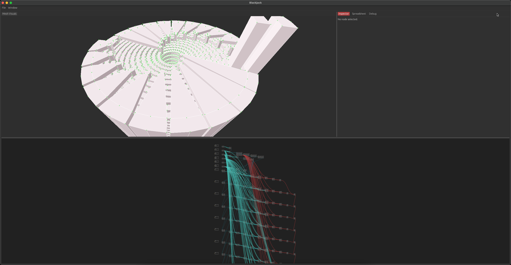
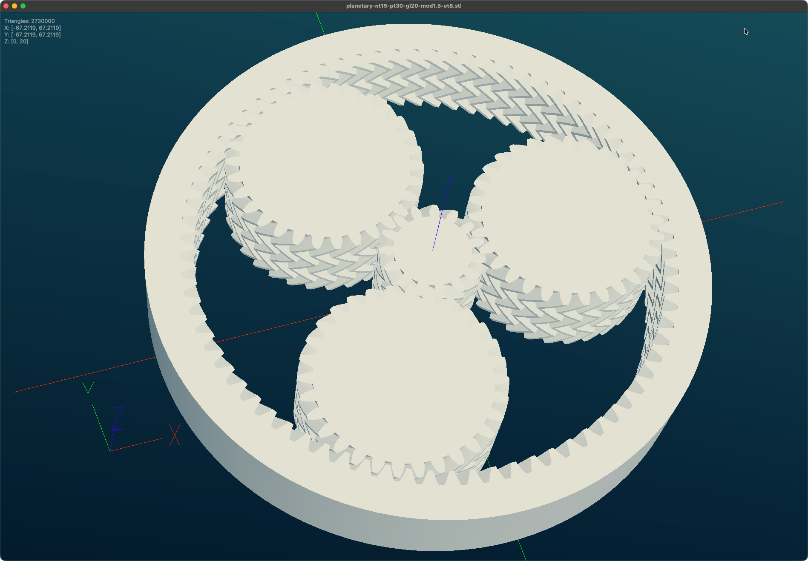

# go-bjk

go-bjk is a Go package used to generate `*.bjk` input files for
the node-based parametric modeling program called "Blackjack":
https://github.com/setzer22/blackjack

It uses [gopher-lua](https://github.com/yuin/gopher-lua) to parse
and execute all the [Luau Programming Language](https://luau-lang.org/)
scripts from the Blackjack repo which enables it to
understand the "standard library" of nodes provided
by Blackjack for use in building a model. Once the node library
is parsed, Go programs can be written that build up a network
of nodes by intelligently connecting the named nodes, inputs,
and outputs, and finally writing out a Blackjack-compatible `*.bjk`
file, ready for parsing.

This package also includes an AST generator using
[Participle](https://github.com/alecthomas/participle) that parses arbitrary
Blackjack `*.bjk` files into Go structs.

## Examples

With the [Go Programming Language](https://go.dev) already installed,
follow these steps in a command-line shell terminal window:

```bash
git clone https://github.com/gmlewis/blackjack
pushd blackjack
BLACKJACK_REPO_DIR=$(pwd)
popd
git clone https://github.com/gmlewis/go-bjk
cd go-bjk
go run examples/bifilar-electromagnet/main.go -repo ${BLACKJACK_REPO_DIR} > bifilar-electromagnet.bjk
```

Then to build and run `blackjack_ui`, you need to have already installed
the [Rust Programming Language](https://www.rust-lang.org/tools/install),
then execute the following code:

```bash
cd ../blackjack
cargo build --release --bin blackjack_ui
./target/release/blackjack_ui ../go-bjk/bifilar-electromagnet.bjk
```

This program will generate a file called "bifilar-electromagnet.bjk" which,
when opened with `blackjack_ui`, will look something like this:



Here is an example of a planetary gearbox, generated by running:

```bash
go run ./cmd/make-planetary-gearbox -nt 15 -planetTeeth 30 -mod 1.5 -gl 20 -tol 0.25 -outerThickness 8 -obj '' -o '' -stl planetary-nt15-pt30-gl20-mod1.5-ot8.stl
```


